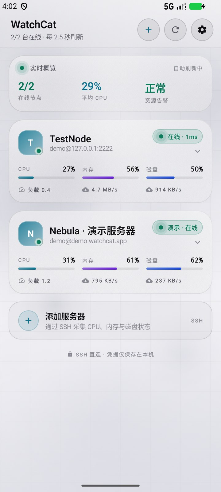
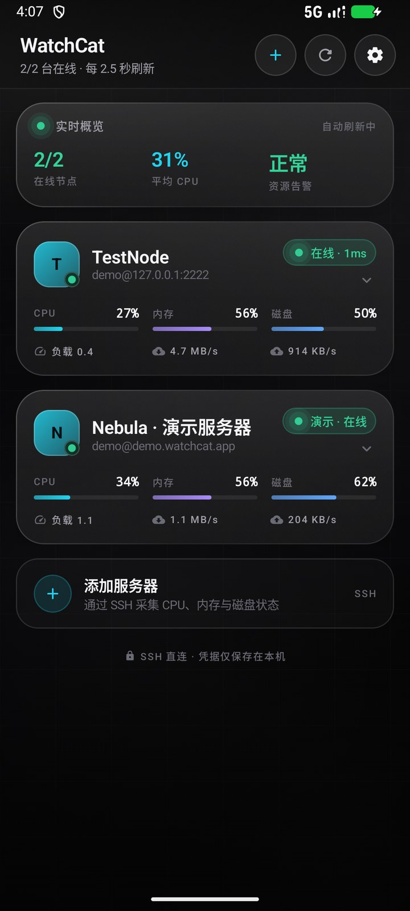
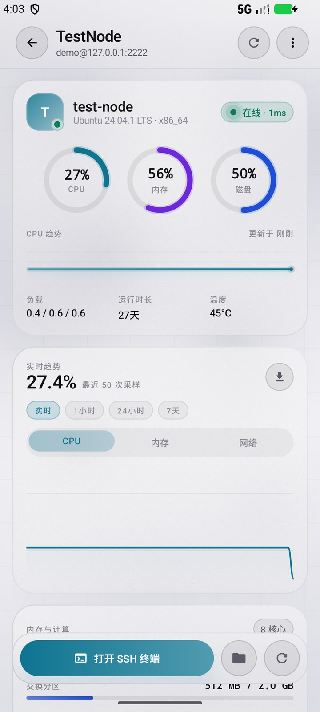
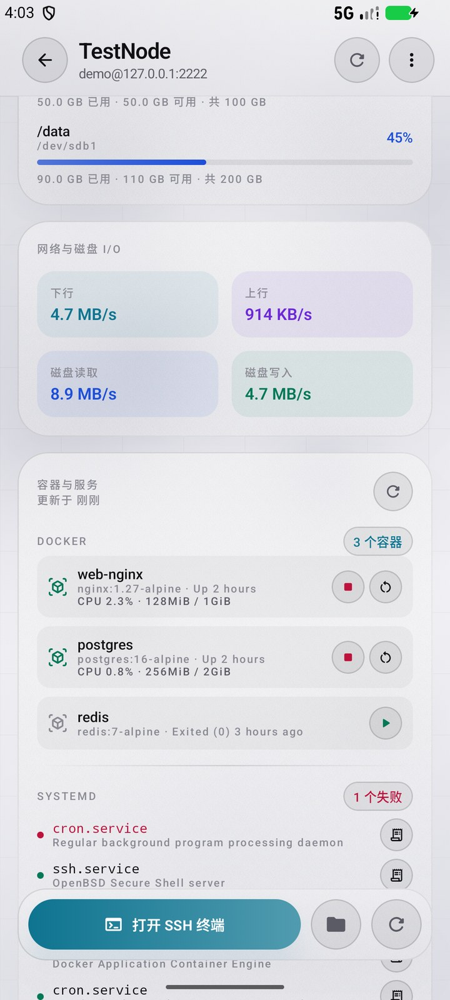
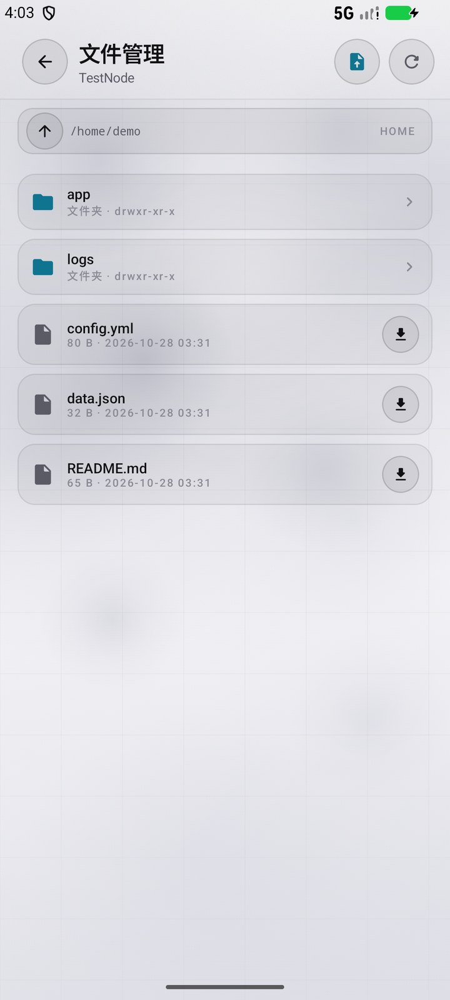
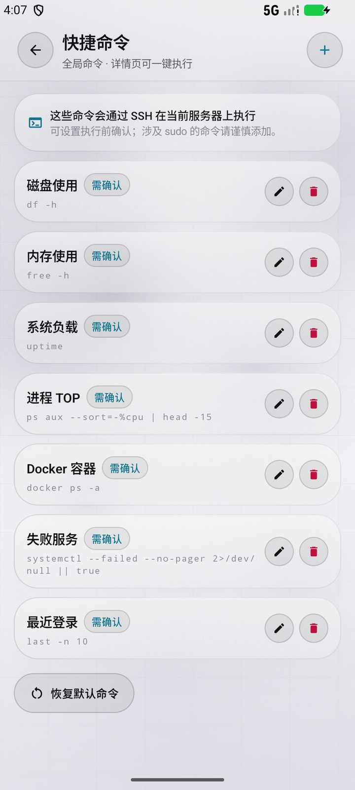
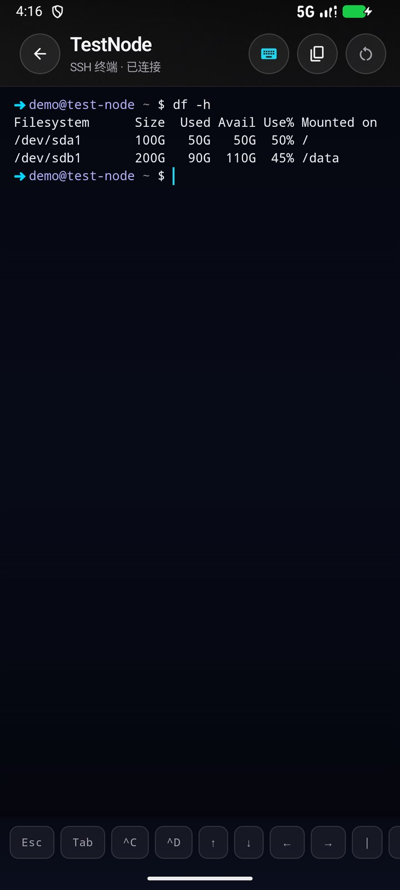
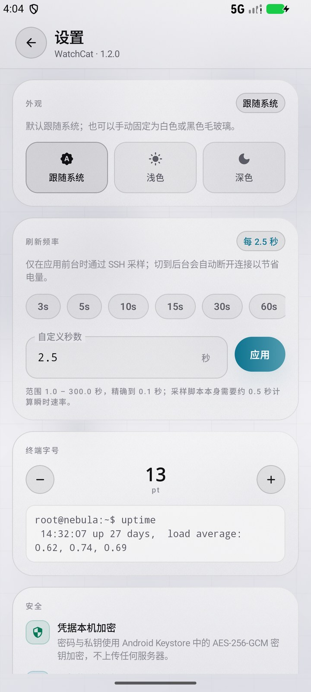

# WatchCat

**为你的服务器做一面安静的玻璃窗。**

WatchCat 是一个用 Kotlin 与 Jetpack Compose 编写的 Android 服务器监控 App。它通过 SSH 直连服务器采集 CPU、内存、磁盘与网络状态，以黑白毛玻璃卡片呈现；需要进入服务器时，还可以直接打开内置终端。

<p>
  
  
  
</p>

<p>
  
  
  
  
</p>

**下载安装包：** [WatchCat v1.0.1 APK](https://github.com/hemo528/WatchCat-Server-Monitor/releases/tag/v1.0.1)（debug 签名，仅用于侧载体验）

> [!IMPORTANT]
> **版本说明**：本仓库公开的源码为 **WatchCat v1.0.1 基础版**。README 的功能介绍与截图展示的是 **v1.2.0** 的完整界面。v1.1 / v1.2 中的历史趋势、Docker / systemd、快捷命令、SFTP 文件管理等高级功能源码，以及安装包，均不在本仓库中。

## 功能

### 基础能力（v1.0.1 源码已包含）

- **卡片式服务器列表**：收起时显示在线状态、CPU / 内存 / 磁盘占用、负载与实时网络速率；点击卡片平滑展开详情。
- **展开态概览**：CPU 趋势、内存与 Swap、运行时长、温度、核心数、磁盘挂载点，以及「完整详情」「SSH 终端」入口。
- **全屏详情页**：三环仪表盘、CPU / 内存 / 网络趋势图、每核心负载、磁盘、网络与磁盘 I/O、系统信息、主机指纹。
- **SSH 终端**：基于 xterm.js 的全屏终端，支持交互式 shell、PTY 尺寸自适应、键盘弹出自动缩放、复制粘贴，以及 Esc / Tab / Ctrl+C / Ctrl+D / 方向键快捷栏。
- **多种认证方式**：支持密码、OpenSSH / PEM 私钥，兼容 RSA、ECDSA 与 Ed25519，可填写私钥口令。
- **主机指纹校验**：首次连接采用 TOFU（Trust On First Use）记录 SHA-256 指纹；指纹变化时阻止连接，详情页菜单可重置。
- **演示模式**：首次安装自带一台本地模拟服务器，不配置 SSH 也能浏览主要界面。
- **黑白毛玻璃主题**：默认跟随系统，浅色为白色毛玻璃、深色为黑色毛玻璃；也可在设置中固定浅色或深色，切换立即生效并持久保存。
- **自定义刷新频率**：支持 1.0 – 300.0 秒，精确到 0.1 秒，同时保留 3 / 5 / 10 / 15 / 30 / 60 秒快捷预设。
- **本地优先与加密存储**：没有账号体系和云端同步；密码与私钥使用 Android Keystore 中的 AES-256-GCM 密钥加密，SSH 流量直接到达你的服务器。
- **省电轮询**：仅在前台采样，切到后台会停止轮询并断开 SSH 连接。

### v1.2.0 完整版界面

以下功能出现在 v1.2.0 的截图与介绍中，但**不包含在本仓库公开的 v1.0.1 源码内**：

- **历史趋势**：SQLite 持久化最近 7 天采样，支持实时 / 1 小时 / 24 小时 / 7 天视图与 CSV 导出。
- **Docker / systemd**：查看容器状态及 CPU / 内存、启动 / 停止 / 重启容器；查看 systemd 运行中或失败的服务及最近日志。
- **快捷命令**：内置磁盘、内存、进程、Docker 等预设，支持自定义命令、执行前确认和结果复制。
- **SFTP 文件管理**：浏览目录、预览与在线编辑文本、上传、下载、删除文件。

## 截图

| 浅色模式 | 深色模式 | 服务器详情 |
| --- | --- | --- |
|  |  |  |

| 容器与服务 | SFTP 文件管理 | 快捷命令 |
| --- | --- | --- |
|  |  |  |

| SSH 终端 | 设置 |
| --- | --- |
|  |  |

> 截图来自 v1.2.0。公开源码 v1.0.1 的卡片、详情、终端、设置与主题效果与截图一致，但不含历史趋势、容器服务、快捷命令和 SFTP 页面。

## 工作方式

```text
Android App
  ├─ Home / Detail / Settings   Jetpack Compose + Material 3
  ├─ Haze                       黑白雾光背景 → 背景模糊 → 玻璃卡片
  ├─ SshManager (JSch)          每台服务器复用一个 SSH Session
  │    ├─ exec metrics.sh       按设定间隔执行 POSIX 指标脚本
  │    └─ shell channel         终端（xterm.js in WebView）
  ├─ MetricsParser              解析指标，计算 CPU / 网络 / 磁盘速率
  └─ ServerRepository           配置 JSON + Android Keystore 加密凭据
```

- 每次采样都会在服务器上执行 `app/src/main/assets/metrics.sh`。脚本读取 `/proc/stat`、`/proc/meminfo`、`/proc/net/dev`、`/proc/diskstats`、`df -kP` 与 `/sys/class/thermal`，通过短暂的 `sleep` 间隔计算瞬时 CPU 与网络速率。
- 指标经 SSH `exec` 通道返回，由 App 解析；指标与终端各自使用独立 channel。
- 终端由 WebView 中的 xterm.js 渲染，Kotlin 与页面通过 `@JavascriptInterface` 双向传输数据；键盘弹出时由 FitAddon 调整 PTY 行列。
- 仅在 App 位于前台时轮询，切到后台会断开所有 SSH 连接以节省电量。
- 主题默认为 `SYSTEM`，背景为中性黑 / 白雾光，卡片使用 Haze 模糊。

## 技术选型

WatchCat 没有重复发明基础控件，而是组合了以下成熟项目：

| 项目 | 用途 | License |
| --- | --- | --- |
| [chrisbanes/haze](https://github.com/chrisbanes/haze) | Compose 毛玻璃与背景模糊 | Apache-2.0 |
| [xtermjs/xterm.js](https://github.com/xtermjs/xterm.js) | 终端渲染引擎（本地 assets） | MIT |
| [mwiede/jsch](https://github.com/mwiede/jsch) | SSH2 协议与认证 | BSD |
| [patrykandpatrick/vico](https://github.com/patrykandpatrick/vico) | Compose 趋势折线图 | Apache-2.0 |
| [valentinilk/compose-shimmer](https://github.com/valentinilk/compose-shimmer) | 加载骨架微光 | Apache-2.0 |
| [Bouncy Castle](https://www.bouncycastle.org/) | JSch 的 Ed25519 / 现代密钥后端 | Bouncy Castle License |
| Jetpack Compose / Material 3 | UI 基础 | Apache-2.0 |

终端交互与 SSH 使用方式参考了 [Termux](https://github.com/termux/termux-app) 和 [ConnectBot](https://github.com/ConnectBot/connectbot)，未直接嵌入其代码。

## 构建

要求：

- JDK 17 或 21（推荐 21）
- Android SDK Platform 36 与 Build-Tools 36.x
- 项目已包含 Gradle Wrapper 8.13，无需单独安装 Gradle

```bash
git clone https://github.com/hemo528/WatchCat-Server-Monitor.git
cd WatchCat-Server-Monitor
./gradlew assembleDebug
```

Windows 下使用 `gradlew.bat assembleDebug`。如果未设置 `ANDROID_HOME`，请在项目根目录创建 `local.properties`：

```properties
sdk.dir=C\:\\path\\to\\Android\\Sdk
```

生成文件：

```text
app/build/outputs/apk/debug/app-debug.apk
```

### 下载 APK

v1.0.1 的可安装包发布在 [GitHub Releases](https://github.com/hemo528/WatchCat-Server-Monitor/releases/tag/v1.0.1)：

```text
文件：WatchCat-1.0.1-debug.apk
SHA-256：35477c72580af408799123eb6b55e8c000d1b0ab3877e9e7a837e35b7a43ef5d
```

```bash
adb install -r WatchCat-1.0.1-debug.apk
```

该包使用 Android Debug 签名，仅用于侧载体验；正式分发前请配置自己的 release keystore。该签名与后续版本不保证一致，覆盖安装前请确认。

单元测试：

```bash
./gradlew testDebugUnitTest
```

测试覆盖 `MetricsParser` 的完整快照、磁盘排序、缺失结束标记和无温度值等场景。

## 使用

1. 点击首页右上角 `+` 或「添加服务器」。
2. 填写地址、端口、用户名，选择密码或私钥认证。
3. 点击「测试 SSH 连接」；首次连接会记录主机指纹。
4. 保存后，卡片开始显示实时指标。
5. 点击卡片展开概览；点击「完整详情」进入全屏页；点击「SSH 终端」进入终端。
6. 在设置中切换浅色 / 深色 / 跟随系统，并调整刷新间隔。

服务器要求：

- Linux，可读取 `/proc`，具备 `awk` 与 `df`；普通用户即可，不需要 sudo。
- SSH 服务允许 shell / exec，指标脚本通过 `/bin/sh` 运行。
- 支持 OpenSSH / PEM 私钥与可选口令。Ed25519 依赖 Bouncy Castle 后端。
- v1.2.0 中的 Docker、systemd 与 SFTP 属于可选能力；对应服务未安装时会显示不可用。

## 安全设计

- **Keystore 加密**：`SecretCipher` 使用 AndroidKeyStore 中的 AES-256-GCM 密钥，密文以 `IV + ciphertext` 的形式 Base64 存储，密钥不可导出。
- **主机指纹**：对服务器主机密钥计算 SHA-256（`SHA256:base64`），首次连接记录，后续不匹配直接拒绝。
- **本地优先**：没有账号系统、云同步或第三方指标服务。
- **禁止备份**：`android:allowBackup="false"`，避免凭据随系统备份外流。
- **WebView 隔离**：终端只加载本地 assets，禁止非 `file://` 导航；终端链接仅交给外部浏览器。
- **最小日志**：不打印密码、私钥或完整连接参数。

## 已知限制

- 毛玻璃依赖 Android 12+ 的 RenderEffect；Android 8–11 会退化为半透明玻璃色调，内容仍可正常阅读。
- 指标采集面向 Linux，不支持 BSD / macOS / Windows Server。
- App 退到后台后会停止轮询并断开 SSH，不提供后台常驻告警。
- 公开源码不包含 v1.1 / v1.2 的高级运维功能，也不提供安装包。
- 暂不支持 ProxyJump 跳板、桌面小组件或多用户同步。

## 目录

```text
app/src/main/java/com/watchcat/app/
  data/          配置、加密、演示数据、模型
  ssh/           JSch 会话、主机指纹、指标解析
  vm/            AppViewModel / TerminalSession
  ui/
    components/  玻璃卡片、环形仪表、Sparkline、趋势图
    screens/     首页 / 详情 / 编辑 / 终端 / 设置
    theme/       黑白毛玻璃主题
app/src/main/assets/
  metrics.sh     POSIX 指标脚本
  terminal/      xterm.js + FitAddon + WebLinksAddon
```

## License

本项目采用 [PolyForm Noncommercial License 1.0.0](LICENSE)：

- 允许个人学习、研究及其他非商业用途；
- **禁止任何商业用途**，包括但不限于直接售卖、付费分发、捆绑销售或作为商业服务的一部分；
- 分发修改版本时须保留许可证与原始版权声明。

如需商业授权，请通过仓库 Issues 联系维护者。
